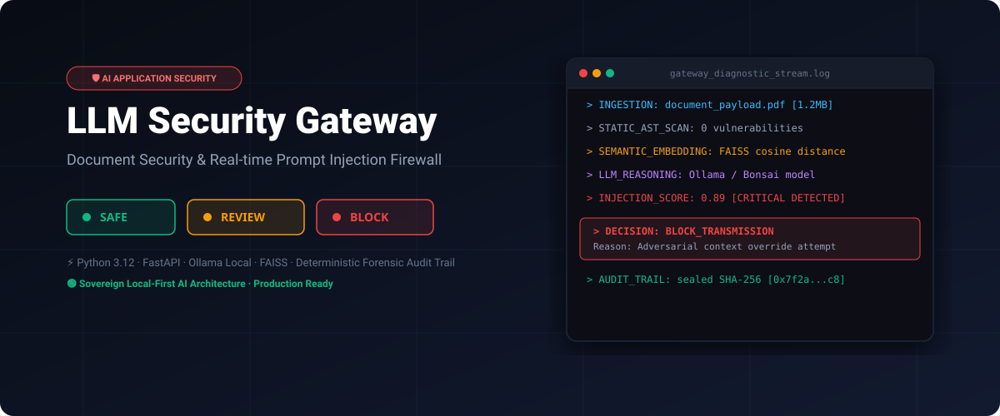
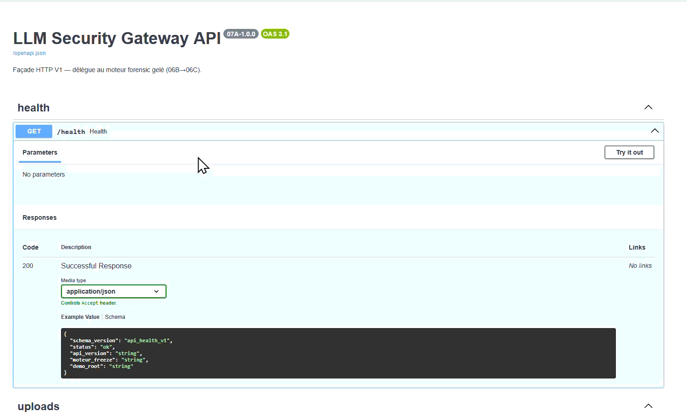

# LLM Security Gateway



> Document security gateway for AI applications — prompt injection risk analysis, evidence review, and clear decisions: **safe · review · block**.

[]()
[]()
[]()
[]()

**Public showcase** for recruiters, clients, and technical reviewers.  
Full core implementation is maintained in a private repository.

[Architecture](./docs/architecture.md) · [MVP status](./docs/mvp-status.md) · [Public vs private scope](./docs/public-vs-private.md) · [LinkedIn MVP demo](https://www.linkedin.com/feed/update/urn:li:activity:7468573770484617216/)

---

## Demo



---

## Problem

Organizations deploying LLM applications need to:

- detect **prompt injection** in documents and user inputs,
- produce **explainable decisions** (not opaque scores),
- maintain an **audit trail** for security reviews.

## Solution

**LLM Security Gateway** is an AI security layer that:

1. ingests text or files,
2. evaluates injection risk through a structured pipeline,
3. returns an actionable decision: **safe / review / block**,
4. supports forensic audit workflows (planning, orchestration, replay).

## Key capabilities

| Capability | Description |
|------------|-------------|
| Prompt injection detection | Static + semantic analysis pipeline |
| Explainable decisions | Structured JSON outputs with clear actions |
| Forensic runtime | Deterministic audit planning and replay |
| Local-first option | Ollama + FAISS for sovereign deployments |
| API-ready backend | FastAPI services for integration |

## Pipeline (operational V1)

```text
text/file
  → ingestion & chunking (02A · 02B)
  → static risk scoring (03A · 03B)
  → LLM diagnostic fusion (04A · 04B · 04C)
  → forensic audit runtime (06B planning · 06C execution)
  → decision: safe | review | block
  → audit plan + JSON reports
```

## Tech stack

| Layer | Technologies |
|-------|--------------|
| Backend | Python, FastAPI, Pydantic |
| AI / ML | Ollama, Sentence-Transformers, FAISS |
| UI (demo) | Streamlit, React + Vite + TypeScript |
| Quality | 16 JSON schema contracts, automated audit scripts |
| Ops | Docker-ready, Git, documented delivery |

## Validation (verified on MVP V1)

```text
Full forensic audit  → RESULTAT GLOBAL: OK
JSON contracts       → 561 OK / 0 KO — PASS
```

## Status

| Item | State |
|------|-------|
| MVP V1 | Frozen — 2026-05-25 |
| Forensic runtime 02A → 06C | Operational |
| API services (07A) | Implemented |
| UI MVP | In progress (React scaffold) |

Details: [docs/mvp-status.md](./docs/mvp-status.md)

## Try the technical demo

A cloneable delivery branch is available on the private technical repository:

```bash
git clone -b livraison https://github.com/snorbik-ai/LLM-Security-Gateway.git
cd LLM-Security-Gateway
# Windows: START_FAST.bat
```

> If the technical repo is private, contact the author for demo access.

## Roadmap

- [ ] Public demo branch linked from this showcase
- [ ] OpenAPI documentation for 07A services
- [ ] Community edition modules
- [ ] Integration guides (RAG pipelines, chatbots)

## About this repository

This is a **showcase repository** — same pattern as professional open-core projects:

- **Here (public):** product vision, architecture, demo media, status, stack
- **Private core:** advanced modules, internal governance, sensitive specs

See [docs/public-vs-private.md](./docs/public-vs-private.md).

## Author

**Tayier NIMAIT** — AI Solutions Engineer  
[LinkedIn](https://www.linkedin.com/in/tayier-dev-ai-data/) · [GitHub](https://github.com/snorbik-ai) · [MVP demo on LinkedIn](https://www.linkedin.com/feed/update/urn:li:activity:7468573770484617216/)

## License

Apache License 2.0 — see [LICENSE](./LICENSE) and [NOTICE](./NOTICE).

---

### Résumé (FR)

Passerelle de **sécurité documentaire IA** : analyse de textes/fichiers, évaluation du risque d'injection de prompt, décision **sûr · à revoir · bloquer**, avec runtime forensique et rapports JSON explicables. MVP V1 gelé le 2026-05-25.
