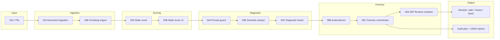

# Architecture — LLM Security Gateway

High-level view of the MVP V1 pipeline. Internal module specs remain in the private core.

## System overview



## Layer model

| Block | Slots | Role |
|-------|-------|------|
| A — Foundation | 00A · 00B | Project baseline |
| B — Data + FAISS | 01A · 01B · 01C | Embeddings, vector index |
| C — Ingestion | 02A · 02B | Document intake, chunking |
| D — Static scoring | 03A · 03B | Rule-based risk signals |
| E — AI diagnostic | 04A · 04B · 04C | LLM-assisted analysis + fusion |
| F — Forensic runtime | 05A → 05F | Canary, payload, capture, evaluation |
| G — Orchestration | 06B · 06C | Planning + deterministic replay |
| H — Stabilisation | scripts | Full audit, JSON contract validation |
| I — API / UI | 07A → 09B | FastAPI services, React MVP UI |

## Design principles

1. **Explainability** — decisions map to structured evidence, not black-box scores.
2. **Deterministic forensic replay** — audit runs are reproducible for review.
3. **Contract-driven outputs** — 16 frozen JSON schemas for integration.
4. **Local-first option** — Ollama + FAISS for deployments without cloud dependency.
5. **Separation of concerns** — ingestion, scoring, diagnostic, and forensic layers are isolated.

## Integration points

```text
External app / RAG pipeline
        │
        ▼
   FastAPI (07A)
        │
        ├── POST /audit/launch
        ├── GET  /decision
        ├── GET  /report
        └── GET  /history
```

## Public vs private

This document describes the **product architecture**.  
Implementation details, internal prompts, and governance specs are in the private core.

See [public-vs-private.md](./public-vs-private.md).
